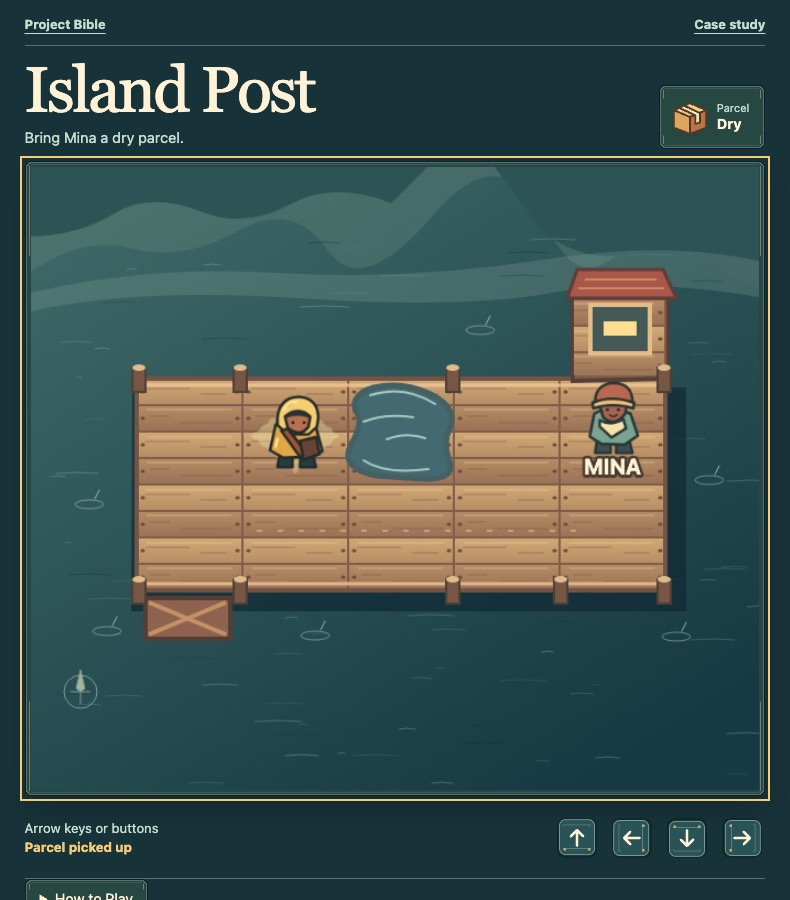
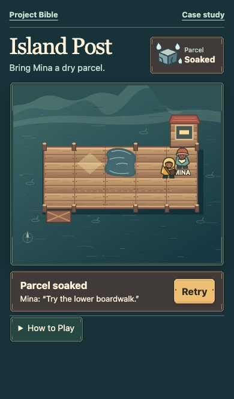
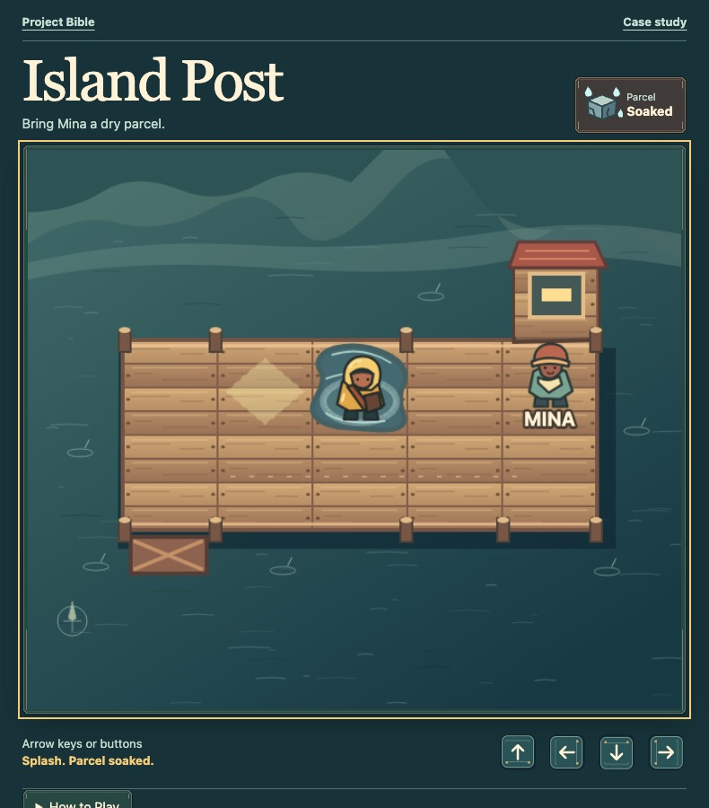
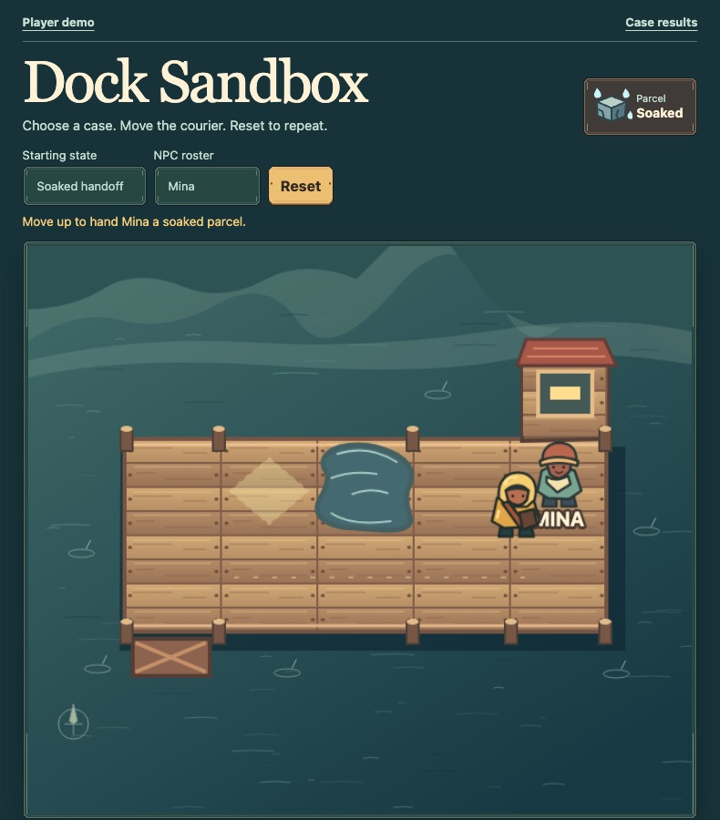
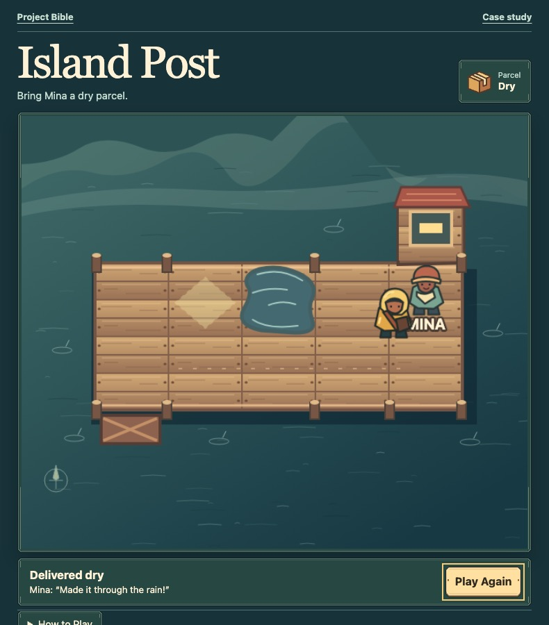

# Island Post: The Dock

[Play Island Post](../island-post/) · [Open the Development Sandbox](../island-post/sandbox/) · [Read the player walkthrough](island-post/first-delivery.md)

Bring Mina a dry parcel. The short path crosses a puddle; the boardwalk gives you a way around it. If you get the parcel wet, you can finish the delivery, take a fresh parcel, and try the other route.

**Release:** Dock 1.0, one free browser delivery. The evidence below comes from the public showcase build or from a named rehearsal. Browser checks cover desktop Chrome and iPhone 13 touch emulation. First-time player sessions and a physical phone check are still open.

## Vision and Scope

**Decision.** Build one Dock delivery that a casual puzzle player can finish in a short browser session using touch or a keyboard. The choice is whether to take the short route through the puddle or the longer route around it. The Dock ends after one delivery. Market Lane, wrapping, and the Hill Route can wait.

**Reference.** The earlier Dock preview proved the short-route decision was playable. The public build keeps that choice and gives the courier, Mina, the Dock, and the controls their own treatment. The [scope brief](island-post/dock-design.md#scope-brief) records what ships and what a first-time playtest needs to show.

## Design Document

**Implemented.** Step onto the parcel, read the fork, and walk to Mina. A puddle soaks a dry parcel on entry. A soaked handoff offers Retry; a dry handoff offers Play Again. The [Dock map and rules](island-post/dock-design.md#dock-map-and-rules) show both paths, the state changes, and where to recover.

## UI and UX Design

**Implemented and checked in the browser.** Put the parcel condition above the map and keep the route clear. Place Retry in the same strip as Mina’s response so it’s within reach when the result appears. Give each direction its own 46 × 44 CSS pixel control. The [HUD sketch and standards](island-post/dock-design.md#hud-sketch-and-standards) explain what to check.

The direction keys, Retry, the parcel HUD, and Mina’s response use artwork from the Dock’s asset folder. When the courier hits a puddle, the splash animates and the parcel frame switches to its soaked artwork. [See the art files and how the controls use them](island-post/ui-art.md).

### Where should Retry appear?

We opened one decision ticket and used [Design Wayfinder](game-development-playbook.md#try-one-live-design-decision) to try two layouts in the playable Dock. In both versions, the player moved right four times to hand Mina a soaked parcel. Retry returned the courier to the fork with a fresh parcel. We checked both layouts with a desktop keyboard and emulated phone touch. [See Retry beside the message](island-post/evidence/retry-beside-phone.jpg) · [See Retry below the message](island-post/evidence/retry-below-phone.jpg)

Joe chose to keep Retry beside Mina’s message so the player can see the result and the action in one compact row. [Try the selected layout in the Dock](../island-post/) · [Run the soaked-handoff case in the Sandbox](island-post/verification.md#sandbox-cases)

The first-time playtest still needs to show whether a player who soaks the parcel finds Retry without coaching. [Read the playtest task](island-post/verification.md#scene-script-and-playtest)

## Engine and Assets

**Built.** Phaser 4.2.1 runs the illustrated Dock scene. Vite packages the Dock and Sandbox as separate browser entries. The public showcase uses original SVG art for the map, courier, Mina, the two parcel states, and the control and frame artwork. The [asset ledger](island-post/dock-design.md#asset-ledger) maps the art to its use and includes the source paths. Try the splash to see how the scene, effect, and HUD work together.

## Audio Engineering

**Example for a future audio pass.** The Dock uses the splash animation and soaked parcel frame to show what happened in the puddle. For an effect, record a few small splashes and try them when a dry parcel becomes soaked. Use Retry to check that the sound plays once on the next crossing. For dialogue, give Mina's dry and wet handoffs separate line IDs and record a take for each. Play the matching line at the handoff, keep the written response on screen, and stop the line if the player chooses Retry.

## Development Sandbox

**Verified in desktop Chrome and iPhone 13 touch emulation.** Open the [Development Sandbox](../island-post/sandbox/). Choose a starting state, move the courier using the game’s controls, then Reset. Pick Mina from the roster and try both handoffs. The [Sandbox record](island-post/verification.md#sandbox-cases) lists the actions and what happened.

## Scene Scripts and Playtests

**Scripted pass; first-time players pending.** The [scene script and playtest task](island-post/verification.md#scene-script-and-playtest) follow the courier from pickup through either handoff. The browser run tested help, a wet delivery, Retry, the dry detour, and Play Again. The next session is to watch someone try the same delivery without telling them which route to take.

## Build and Play the Game

**Playable build.** Open [Dock 1.0](../island-post/) in a fresh tab and play a complete delivery. The [build record](island-post/verification.md#build-record) gives the command, expected entry points, and replay steps. The player entry has no developer case picker or Reset.

## Demo Manual and Wiki

**Playable and documented.** The demo uses the Sandbox’s verified pickup, puddle, handoff, and Retry rules in one continuous delivery. Read [Make your first delivery](island-post/first-delivery.md) for the walkthrough and [Wet parcels](island-post/wet-parcels.md) for the rule and recovery steps. In the demo, open How to Play and close it to keep going from the same square.

The [capture sheet](island-post/release-kit.md#capture-sheet) pairs the actual fork, splash, and dry handoff with the public play link. [Watch the delivery](island-post/evidence/dock-walkthrough.webm).

## Release Pricing and Marketing

**Public showcase.** Dock 1.0 is free to play in a browser and requires no account, download, or payment. The [release kit](island-post/release-kit.md) includes the pitch, screenshots, and a public entry check. The Bible’s Publish Bible workflow ships the same built files that the release check exercises.

## Contributor Training

**Clean checkout exercise.** Follow the [contributor exercise](island-post/operations.md#contributor-exercise) to build the site, change one Sandbox cue, and verify the result. The exercise keeps the movement and handoff rules in one place.

## Updates and DLC

**Rehearsal.** The [update rehearsal](island-post/operations.md#update-rehearsal) tries a clearer puddle instruction in the built help and checks that pickup, wet handoff, Retry, and the dry detour still work. There are no saves or purchases in Dock 1.0. This exercise does not add a route or ship an expansion.

## Intake and Feedback

**Rehearsal.** The [intake record](island-post/operations.md#intake-rehearsal) follows a real finding from the first staged build: the playfield opened, but the courier and controls never became ready. It records the evidence, the fix, the retest, and the release check that came out of it. It also explains where to report a problem and what we still need to learn from players.

[Return to Vision and Scope](#vision-and-scope) · [Play Island Post](../island-post/)
