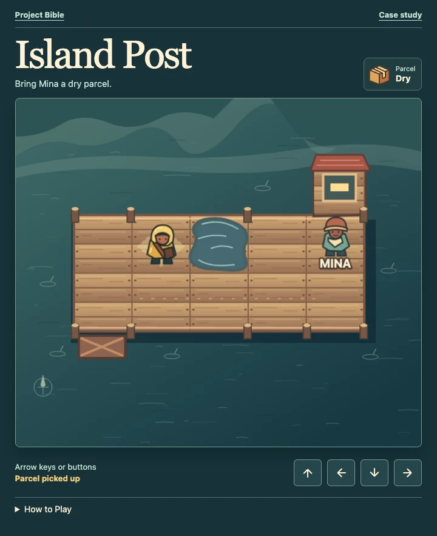

# Make your first delivery

[Play Island Post](../../island-post/)

1. Move right once to pick up the parcel. Use your arrow keys or tap a direction under the map.
2. At the fork, move down to the lower boardwalk. Follow it right until you’re below Mina.
3. Move up to hand the parcel to Mina. Look for **Delivered dry**.

## Try again after a wet delivery

If you step in the puddle, the parcel stays soaked. Walk the rest of the way to Mina, choose **Retry**, and take the lower boardwalk with the fresh parcel.

[Try the delivery](../../island-post/) · [Look up wet parcels](wet-parcels.md)
