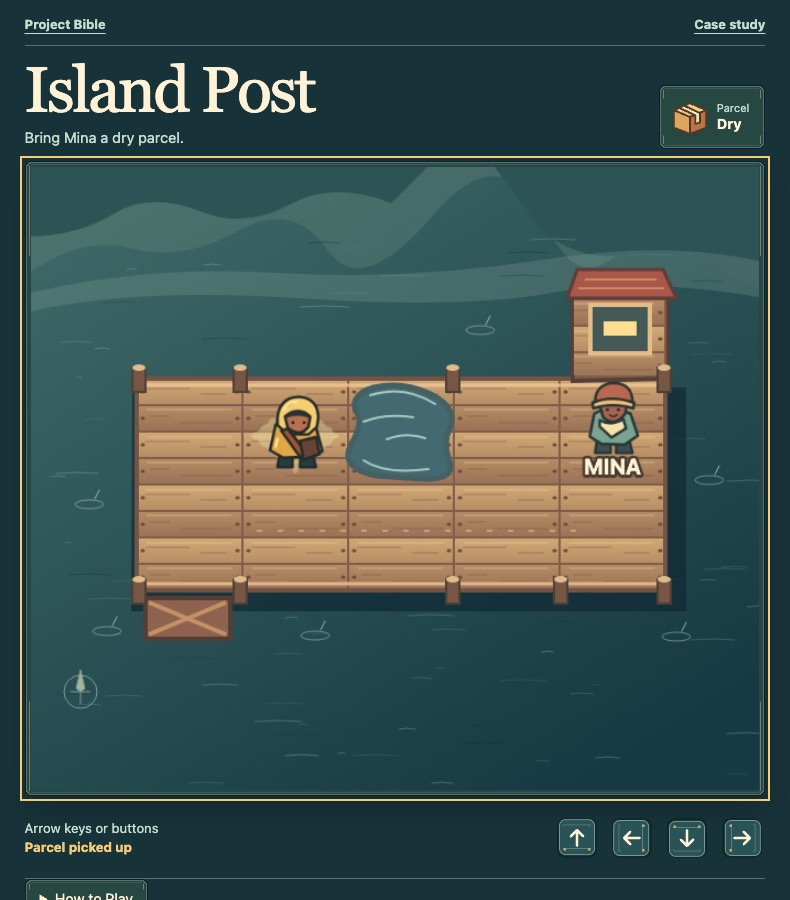
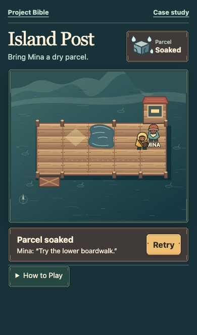

# Make and wire the Dock’s interface art

[Play the Dock](../../island-post/) · [Open the Sandbox](../../island-post/sandbox/) · [Read the asset ledger](dock-design.md#asset-ledger)

The Dock uses green enamel and brass to give the controls the same weathered look as the boardwalk. A dry parcel sits in a green frame. When the courier steps in the puddle, the splash plays over the map and the HUD switches to a soaked parcel and a brown frame. The label changes to Soaked at the same time.

| Piece | Artwork files | Where to see them |
| --- | --- | --- |
| Direction button | [Idle](ui/direction-idle.svg) · [Highlighted](ui/direction-active.svg) | Move up, down, left, or right. The four buttons rotate the same image. Hover, press, or tab to one to see the highlighted art. |
| Brass button | [Idle](ui/button-brass.svg) · [Highlighted](ui/button-brass-active.svg) | Retry, Play Again, and the Sandbox Reset share the button art. The label comes from the control. |
| Panel frame | [Dry](ui/frame-dry.svg) · [Soaked](ui/frame-soaked.svg) | The parcel HUD and Mina’s result use the frame that matches the state. The map and Help reuse the dry frame. |

## Make the files

1. Pick a look that belongs with the project’s art. Sketch the main screen and a result or menu before drawing the pieces. Mark which areas will hold labels and which states need a visual change.
2. Draw or generate the pieces and export each reusable button or frame. Keep state variants aligned so switching the image doesn't move the label or hit area. For a frame that needs to grow, keep the corners clear of the area that stretches. Leave room for a long label and keep text editable in the interface.
3. Save the editable source and build files with the project. The Dock’s SVG files in `examples/island-post/assets/ui/` serve as both. The Bible build publishes sample copies from those same files.

## Put the files in the game

The Dock loads the artwork by URL in `examples/island-post/style.css`. Its native buttons handle touch, mouse, and keyboard. CSS rotates the direction image and uses nine-slice scaling to keep the corners of the brass button and panel frames intact as the center grows. The transparent border gives the asset a place to render. A visible focus outline follows the active control.

`examples/island-post/dock.js` writes the parcel and delivery state, sets the icon and labels, and plays the splash. The HUD and response select the matching frame file. For a canvas-only interface, load the same pieces as textures, attach hit areas and accessible input, and select the texture for the current state. A lightning flash could play over a menu while the menu swaps to a separate illuminated frame.

## Try it

1. In the Sandbox, choose **Puddle** and move right. Look for the splash, the soaked icon and label, and the new frame. Reset and watch the dry artwork return.
2. Choose **Soaked handoff**, move up to Mina, and activate **Retry**. The brass button appears alongside the response and receives keyboard focus. Retry returns focus to the board and restores the dry parcel and frame.
3. Choose **Dry handoff** and move up. Activate **Play Again**. Check both runs with keyboard and touch, including the focus and highlighted art and whether the label still fits on a narrow screen.

[Read the browser check results](verification.md#interface-art-check)
