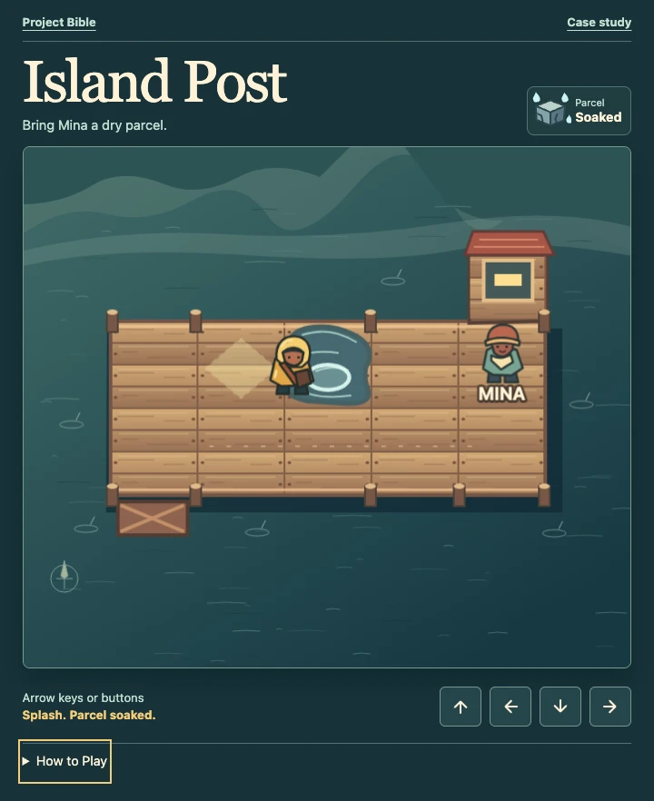

# Wet parcels

A parcel soaks as soon as you step into the puddle. Look for the splash and the **Soaked** label beside the dripping parcel icon. Walking onto dry boards won't dry it out.

To get a fresh parcel, finish the delivery and choose **Retry** next to Mina’s response. You'll start at the fork with a dry parcel. Go down to take the boardwalk.

[Open Wet parcels in the demo](../../island-post/#wet-parcels) · [Read the retry walkthrough](first-delivery.md#try-again-after-a-wet-delivery)
