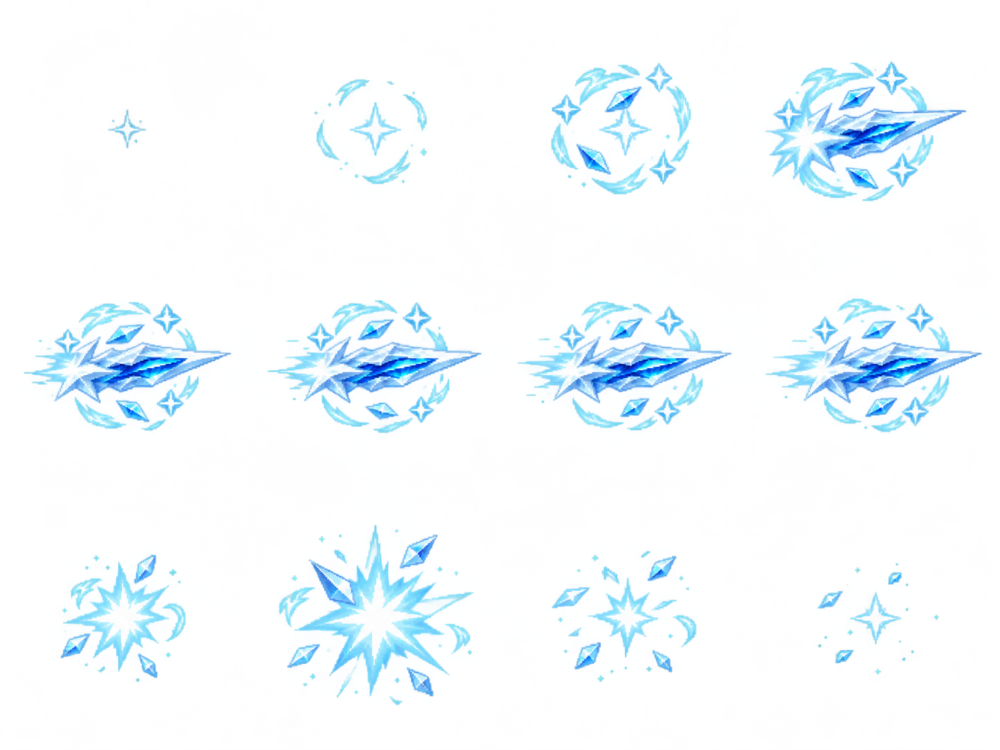

# Frostbolt spell art

The [spellbook illustration](frostbolt-inventory.webp) is the visual reference for the [transparent gameplay sheet](frostbolt-spritesheet.png). [Cast Frostbolt at 1×](frostbolt-preview.html) to see the charge ring, the moving ice spear, and the impact burst beside the full illustration.

## Export and frame map

The PNG has 48 frames in an eight-column, six-row grid. Each cell is 48 × 48 pixels, with its origin at (24, 24). Four three-row blocks cover right and left across the top and up and down across the bottom. Within each block, the first row is cast, the second is flight, and the third is impact. The [JSON frame map](frostbolt-frames.json) gives each direction, its row indices, and its timings.

| Stage | Frames per facing | Frame time | Where to draw it |
| --- | ---: | ---: | --- |
| Cast | 4 | 90 ms | At the caster’s release point |
| Flight | 4 | 70 ms | At the moving projectile; loop while it travels |
| Impact | 4 | 100 ms | At the contact point, then clear |

The preview advances the projectile a short distance in the selected direction and plays the impact at the far end. In a game, trigger the impact from the collision or other spell rule. Use the actual caster, projectile, and contact positions.

## Generated poses

ImageGen made the illustration and used it to draw the twelve source poses together. The export crops the transparent margins, samples at a shared scale, and centers the effects. It mirrors the art for left and turns it for up and down.

### Spellbook prompt

Create a single polished fantasy game spellbook item illustration of the spell FROSTBOLT, genuinely transparent background, square composition, full entire artwork inside canvas with breathing room. Centered large unmistakable elongated spear-shaped ice crystal pointing right, angular icy-white edge, vivid sapphire-blue inset core and three distinct small diamond-shaped ice shards. A delicate pale-cyan broken halo of frost curls behind the crystal, with three nearby geometric snowflake glints. Make the ice the unmistakable single subject. Hand-painted collectible spell icon for the full illustrated spellbook inspection view, rich faceted detail, cool cyan and indigo with frosty white highlights, strong readable silhouette, restrained small effects, no orb, no book, no text, no panels, no scenery, no hands, no character, no checkerboard or opaque backing. The silhouette of the ice spear and its three diamond shards must translate to a small game sprite.

### Gameplay sheet prompt

Use this uploaded Frostbolt spellbook illustration as design reference. Make a precise source sprite sheet for this exact blue-white ice spell, an original 2D pixel-art effects animation that preserves the tapered ice lance, deep sapphire facet, three diamond-like chips, and frost halo of the reference. EXACTLY 3 ROWS and 4 COLUMNS of art on a square-ish canvas (4:3). Twelve equal square slots, each frame centered in its own slot with generous transparent margins and no crossing into neighbors. REAL transparent background (all non-effect pixels at alpha zero), crisp pixel-art clusters, no opaque background, checker, grid, frame labels, text, scenery, wand, hands, characters, or shadows. Consistent palette and scale. In ROW 1 left to right, cast: a tiny pale four-point frost star, thin broken cyan ring and frost star forming, a swollen brighter ring with three diamond shards closing toward the star, then a compact bright blue-white release flash with the tip of the ice lance emerging to the RIGHT. In ROW 2, flight: four consecutive matching views of the SAME horizontal right-pointing blue ice lance, with faint blue streak trailing behind to the LEFT and three tiny diamond chips changing position subtly between frames. The main lance body stays centered, same size and orientation in all four frames, only the small particles and glint animate. In ROW 3, impact at one fixed center: bright compressed ice flash, large star-shaped impact with clear angular ice splinters, much smaller spread of four or five broken diamond chips as the center fades, then just a few tiny frost particles. Make the middle impact the broadest pose but keep it inside its cell. Center the effect at the same point in each slot. Use sharp pale cyan highlights, ice blue middle values and limited dark sapphire, deliberate old-school game VFX pixels, easily readable when a slot is exported to 48 by 48 pixels. Render all twelve frames as one coherent game art sheet.
