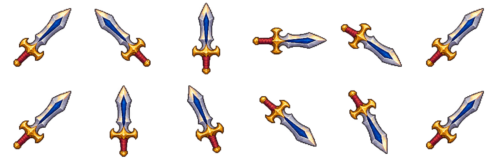

# Fighting-game sword art

The [painted inventory illustration](sword-inventory.webp) is the visual reference for the [transparent gameplay sheet](sword-spritesheet.png). [Play the equipment layer at 1×](sword-preview.html) to see how the sword moves beside the full illustration. The preview plays the exported frames. In a game, attach the grip to the fighter’s hand and check the pose and draw order throughout the swing.

## Export and frame map

The PNG is 384 × 512 pixels, with six columns and eight rows of 64 × 64 pixel cells. The grip is at (32, 32) in each cell, measured from the upper-left corner. The [JSON frame map](sword-frames.json) gives each action and direction’s frame indices, delays in milliseconds, and return to guard.

| Facing | Slash frames | Overhead chop frames |
| --- | --- | --- |
| Right | 0–5 | 24–29 |
| Left | 6–11 | 30–35 |
| Up | 12–17 | 36–41 |
| Down | 18–23 | 42–47 |

Read each row left to right: guard, wind-up, transition, strike, follow-through, and guard. The chop holds longer at the top. Mirror the right-facing art for left and turn it around the grip for up and down in this flat equipment-layer example. If the fighter changes perspective or moves the hand, use the matching character pose to position the layer and verify it in the game.

## Generated poses

ImageGen drew both strips from the approved inventory illustration in one pass. A second pass removed the backdrop. The export samples all poses at one scale with nearest-neighbor filtering, centers each pose on the red grip, and uses the same guard at the beginning and end.

**Generation prompt.** Use the uploaded inventory illustration strictly as the sword identity reference. Draw an ORIGINAL coherent pixel-art GAME ANIMATION source sheet of that exact sword as a rigid equipment layer. Preserve the broad silver steel blade, deep blue elongated inset facet, curved scalloped gold crossguard, crimson wrapped handle and tiny gold pommel. Pixel art has crisp stair-step edges and warm, rich metallic colors. Exactly TWO rows and SIX columns of isolated sword-only poses on genuine transparency, on a wide 3:1 canvas. Exactly 12 swords, with each centered separately in its own equal square cell with generous empty margin; nothing overlaps a neighboring cell. No text, grids, hands, people, frame outlines, scenery, or floating effects. Draw the whole sword at the same scale in every cell, as if an invisible wrist rotates it by the same grip. Every frame must have one intact blade and one complete grip. ROW 1 depicts one right-facing sweeping slash. Left to right, blade points (1) NE ready, (2) NW wind-up, (3) N passing overhead, (4) E strike, (5) SE follow-through, (6) NE return to guard. ROW 2 depicts one right-facing overhead chop. Left to right, blade points (1) NE ready, (2) N lifted, (3) NNW at apex, (4) SE accelerating forward and down, (5) SSE low follow-through, (6) NE return to guard. Render the swords in a single clean orthographic side plane; choose a very clear silhouette, brighter pale highlights on steel, saturated deep blue center and gold and crimson clearly readable at around 48 pixels. One regular production sprite-animation grid, no extra designs. Keep the center of the grip easy to locate at the red portion midpoint.

## Layout references

- The Mana World defines its short sword as a separate equipment sheet with timed attack and chop sequences for all four facings. [Sprite sheet](https://github.com/themanaworld/tmwa-client-data/blob/master/graphics/sprites/equipment/weapons/sword-short.png) · [Animation XML](https://github.com/themanaworld/tmwa-client-data/blob/master/graphics/sprites/equipment/weapons/sword-short.xml)
- This Liberated Pixel Cup entry shows a sword and rapier alongside the corresponding character slash poses. [LPC medieval fantasy character sprites](https://lpc.opengameart.org/content/lpc-medieval-fantasy-character-sprites)
