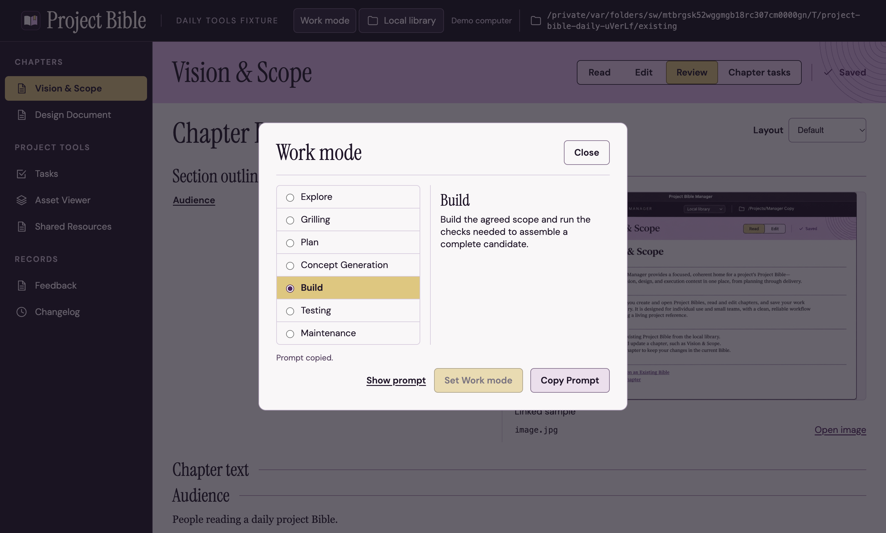
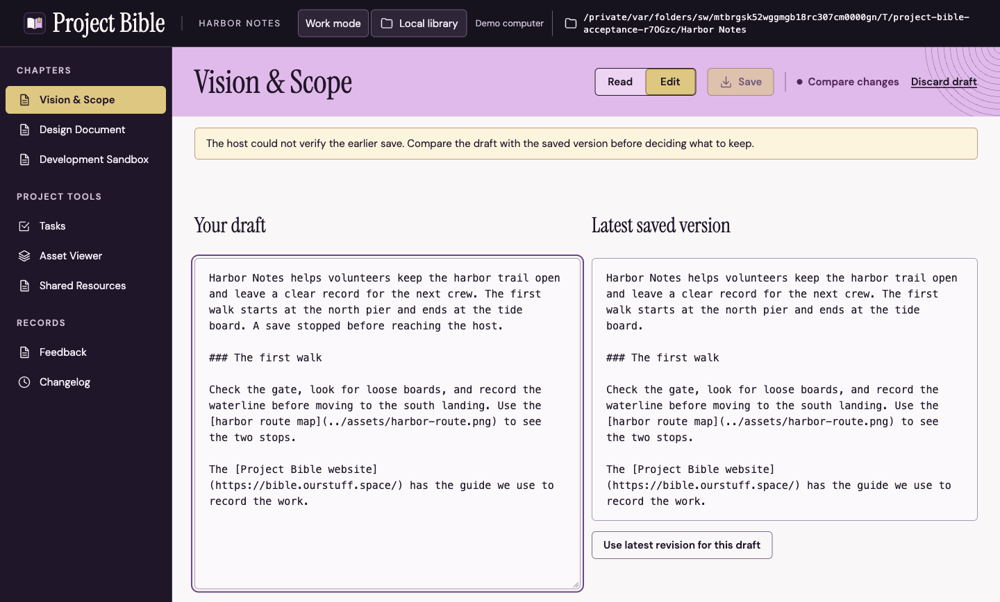

# Work With Agents

[All tutorials](index.md)

- [Start with the same Bible](#start-with-the-same-bible)
- [Work through decisions and tickets](#work-through-decisions-and-tickets)
- [Connect an agent through MCP](#connect-an-agent-through-mcp)
- [Review saves and recover a draft](#review-saves-and-recover-a-draft)

## Start with the same Bible

Give the agent the project name, the exact working folder or library, the chapter, and the outcome for this session. Start with the [Project Bible skill](../project-bible/SKILL.md) and [agent resource index](../agent-index.md). If the agent works in your repository, start it from the project root and point it at the existing Bible and Task List. If the files belong to a library the agent can access through MCP, use the library setup below.

In the Desktop Manager, open the chapter and choose **Work mode**. Choose the mode, select **Set Work mode**, and use **Copy Prompt** when you want the agent to pick up that chapter with the right instructions. Add the result you want to the prompt.

> Open Harbor Notes in the working folder I've selected. Read Vision & Scope and its open tasks. Ask me what a volunteer needs to leave for the next crew. Capture my answer in Vision & Scope and show me the related task and how we'd check it.

## Work through decisions and tickets

In **Explore**, give the agent a real example and ask it to bring you evidence and options. In **Grilling**, answer the key questions and have the agent save your decisions where they belong. In **Plan**, use [Auto Plan](../auto-plan/SKILL.md) to draft the chapters, plan their tasks, and prepare Concept Generation. When you’re ready to implement, use the [development ticket workflow](../task-list-workflow.md#turn-an-agreed-plan-into-work) and give the agent one ready ticket with its acceptance check.

Have the agent return the exact chapter or ticket it updated and the result it verified. Read the change in your Bible. If you accept a different decision, put it in the owning chapter so the next agent starts there. A suggestion in chat stays a proposal until you decide to use it.

## Connect an agent through MCP

1. Open the library in the Desktop Manager. In **Settings → Agent connection**, use the configuration instructions for that library. For a local library, keep the app running and use its local endpoint record. For a hosted library, use the HTTPS URL and the scoped token issued by the operator. Keep credentials in your agent client's private settings.
2. Start the agent client with that configuration. Ask it to run `describe_library` and `list_bibles`. Confirm the library name, Bible name, and working folder before it edits. The agent can retrieve the matching skill with `get_skill`.
3. Have the agent read the chapter before saving. A save uses the revision it read. Have it reopen the chapter and report the new revision or show you what changed. For import, export, or removal, have it show the preview for the exact Bible and destination first.

If your client asks for a command and arguments, use Node and the absolute path to `dist/src/mcp/cli.mjs` in the built app bundle or host package. For a local profile, set `PROJECT_BIBLE_LOCAL_ENDPOINT` to its `library/agent-endpoint.json` path. For a hosted library, use `PROJECT_BIBLE_URL` and `PROJECT_BIBLE_TOKEN`. If the operator uses a private certificate authority, configure the supplied CA through `NODE_EXTRA_CA_CERTS`. Use one connection per library and verify each connection before handing it work.

## Review saves and recover a draft

Try this with Harbor Notes. Open **Vision & Scope** and add a sentence in **Edit** about who checks the route markers. Keep your draft open. Ask the agent to add a separate sentence about the tide board and save it. Then save your draft.

If the agent saved first, **Compare changes** shows your draft beside the latest saved version. Decide which wording to keep, bring those changes together, and select **Use latest revision for this draft**. Save and reopen the chapter to check both sentences. If a reply was lost, use **Check save** before retrying. Compare against the latest version whenever another save or an uncertain outcome intervenes.

