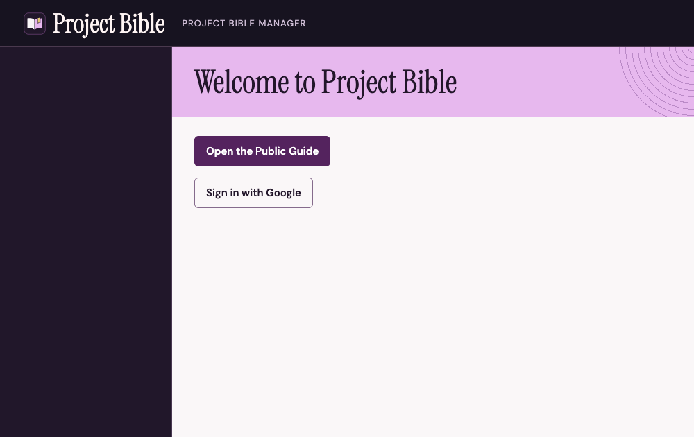
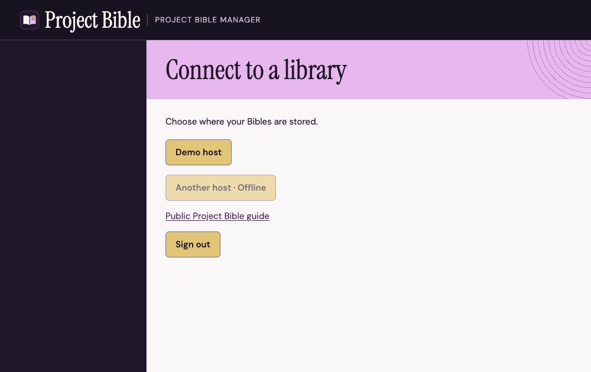
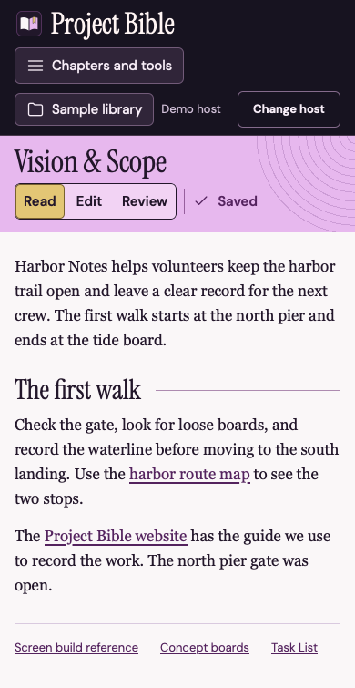

# Browser Client

[All tutorials](index.md)

- [Open the guide or sign in](#open-the-guide-or-sign-in)
- [Choose the host that owns your Bible](#choose-the-host-that-owns-your-bible)
- [Read or edit from another device](#read-or-edit-from-another-device)
- [Reconnect or switch hosts](#reconnect-or-switch-hosts)

## Open the guide or sign in

Open [Project Bible 2.0](https://bible2.ourstuff.space/) on your computer or phone. Choose **Open the Public Guide** for the chapters and this tutorial. To open a private library, choose **Sign in with Google** and use the account your library operator approved. If you need access, ask the operator which account to use.

## Choose the host that owns your Bible

After sign-in, choose the machine where the Bible's working folder is registered. A computer running the Desktop Manager can make its local library reachable through a configured browser gateway. A separate server can host another library. Their lists can differ, so check your library name and working folder before editing.

An offline host can't open until its library is running and reachable. If your Bible normally lives on a Mac, open Project Bible on that Mac and try the chooser again. If it lives on a separate server, check with whoever runs that host.

## Read or edit from another device

1. Select the Bible and choose **Open Bible**. Open the chapter you need and check its current text and links.
2. Choose **Edit**, change the chapter, and choose **Save**. Wait for **Saved**. Reopen the chapter to check your change. The save goes to that library's working folder, so someone opening the same Bible on the host sees the same result.
3. If **Compare changes** opens, read your draft and the latest saved version before deciding what to keep. Use the Desktop Manager for managing folders, backups, import, and export.

## Reconnect or switch hosts

If your session ends, reconnect and confirm which host and Bible you opened. If a save reply was interrupted, check the draft's save status and compare it with the chapter before repeating the edit. To go to a different library, choose **Change host** and select the other library. On a shared device, return to the chooser with **Change host**, then select **Sign out**.
