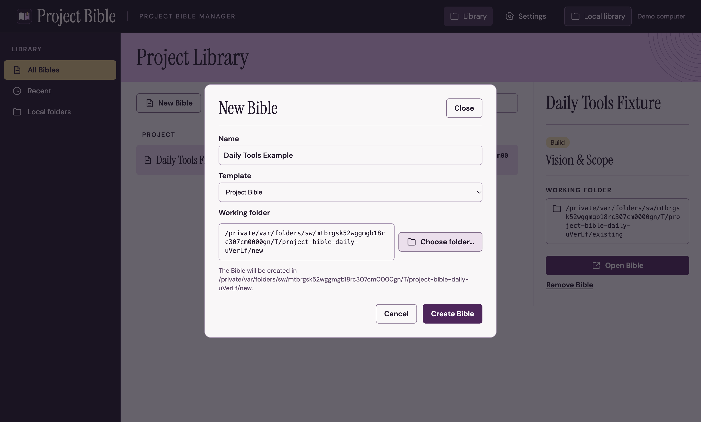
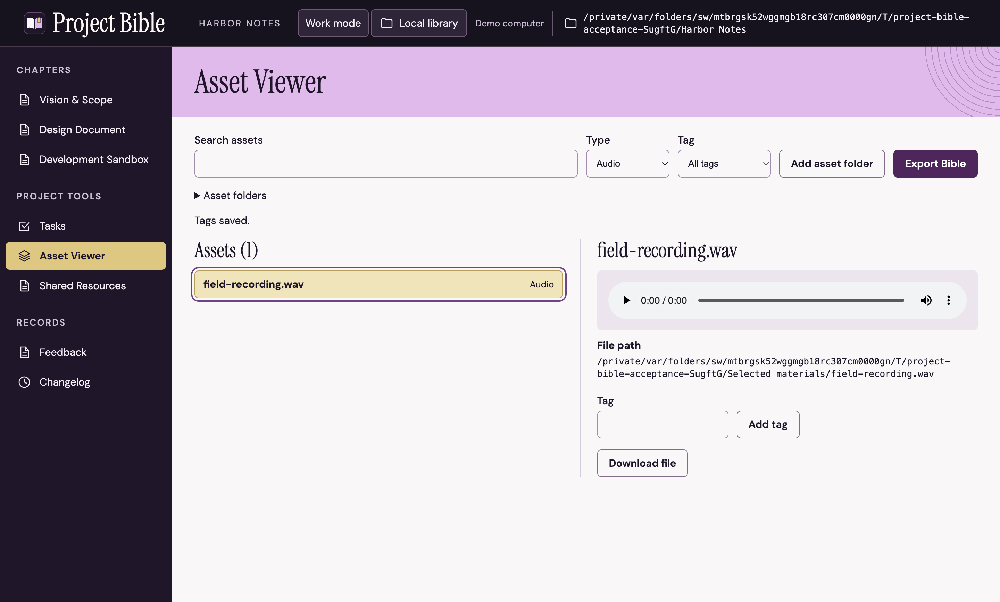
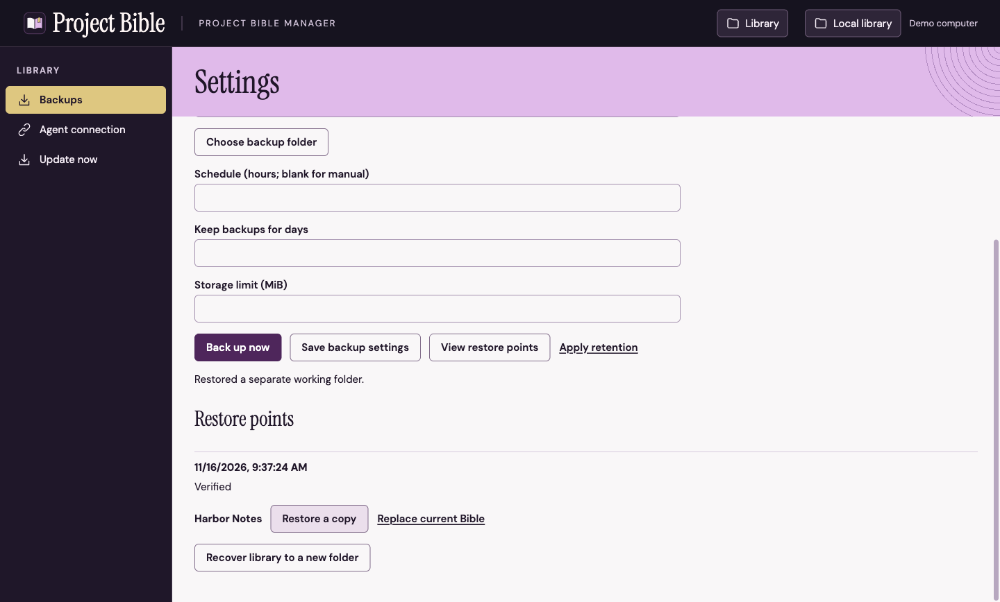

# Desktop Manager

[All tutorials](index.md)

- [Open or connect a library](#open-or-connect-a-library)
- [Create, add, or import a Bible](#create-add-or-import-a-bible)
- [Read, edit, and review a chapter](#read-edit-and-review-a-chapter)
- [Work with assets and export a copy](#work-with-assets-and-export-a-copy)
- [Update, back up, and recover](#update-back-up-and-recover)

## Open or connect a library

Install the app using the package your library operator provides. The [2.0 sign-in page](https://bible2.ourstuff.space/) offers the private Apple silicon Mac installer to authorized accounts. Open **Project Bible** from Applications on a Mac.

Choose **Start a library on this computer** for your own working folders. Choose **Connect to an existing library** when the operator has given you a hosted library connection. The library tells the app which Bibles it can open, and each Bible has a working folder on that host. Check the library and folder shown in the app before making changes.

## Create, add, or import a Bible

- Use **New Bible** to put a starter Bible in a folder you choose.
- Use **Add Existing** for a project that already contains a Bible. The app registers that folder and opens the files there.
- Use **Import Bible** to bring in a copy. Read the preview, including any duplicate, before choosing how to proceed.
- In your local library, choose **Open demo** to practice with a fresh Harbor Notes copy.

## Read, edit, and review a chapter

Open a Bible from the Library, then use the chapter navigation. In **Read**, open the links and check the current text. In **Edit**, make a small change, choose **Save**, and reopen the chapter to confirm it. Your changes save to the working folder. When the app asks you to compare a draft with a newer save, follow the [draft recovery practice](agents.md#review-saves-and-recover-a-draft).

Use **Review** when you're checking the chapter or its tasks. Pick a layout for the job, such as the work queue when you need to see what you can pick up. **Tasks**, **Feedback**, **Changelog**, and **Shared Resources** give you a place to track work, leave evidence, and find the shared templates and guides.

## Work with assets and export a copy

Open **Asset Viewer** to find pictures, audio, files, and links for this Bible. Search by name or filter by type or tag. Open a preview and add a tag that will help someone find the material later. For Harbor Notes, find the route map and tag it `route`.

Choose **Export Bible**, select a separate folder, and review the links and missing files in the preview. Open the exported folder with **Add Existing** in a practice library. Check a chapter, an asset link, and the tag. When removing a Bible from your library, read the exact folder in the confirmation and use the keep-files option if you only want to remove the library entry.

## Update, back up, and recover

In a local library, open **Settings → Backups**. Choose a backup folder, set a schedule or keep manual backups, and select **Back up now**. Open **View restore points** and use **Restore a copy** to practice without replacing the working Bible. Reopen the restored copy and check the chapter and links you expected. If you use another host, ask the operator how that library is backed up and who restores it.

Check the app's update settings for the current version and available updates. Use the configured update source and review the version before applying an update. Keep a verified backup for changes you may need to recover.

