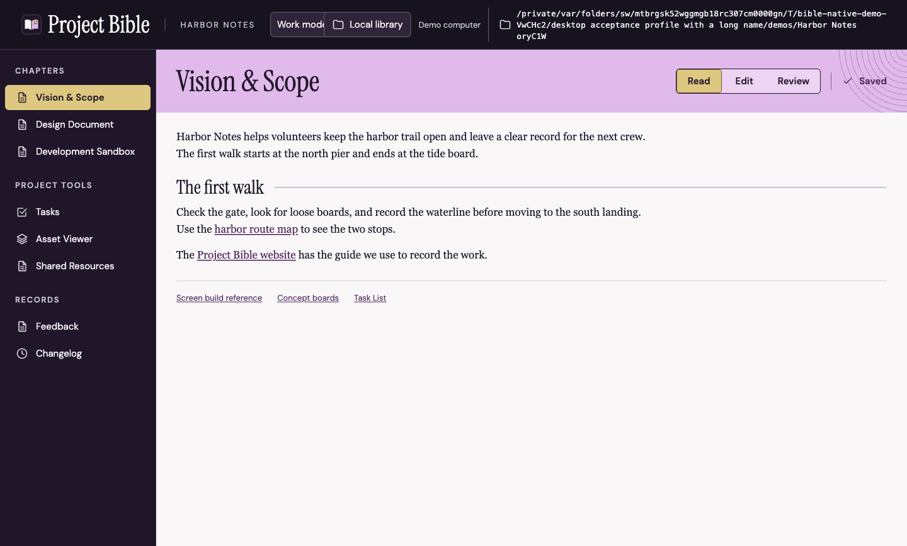
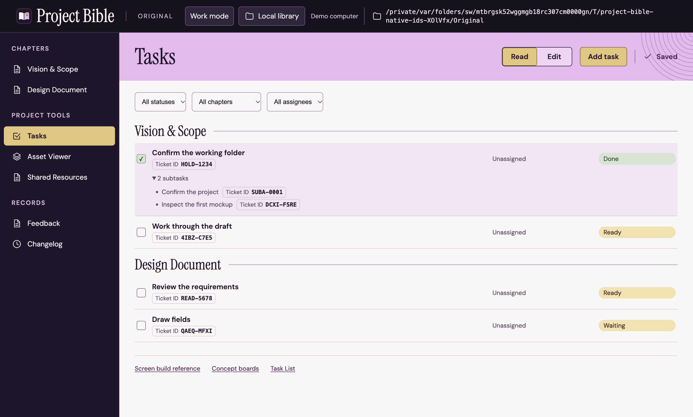

# Work Solo

[All tutorials](index.md)

- [Give the project a home](#give-the-project-a-home)
- [Choose the chapter and Work mode](#choose-the-chapter-and-work-mode)
- [Turn a decision into work](#turn-a-decision-into-work)
- [Check the result and keep going](#check-the-result-and-keep-going)

## Give the project a home

1. Decide where you'll keep the project's files. In the Desktop Manager, use **New Bible** to start from the template. If you already have a project Bible in a working folder, use **Add Existing**. You can also [set up the Markdown files in a project repository](../../AGENTS.md) and work in your own editor.
2. Open **Vision & Scope**. Write who the project is for, what they should be able to do, and what would tell you the first release is ready. Name one thing you can try soon.
3. Keep the Bible and Task List in that folder. Link sketches, builds, feedback, and other evidence from the chapter where someone would need them.

In Harbor Notes, the first outcome is small enough to walk through. A volunteer can start at the north pier, find the tide board, and leave a reading the next crew can find.

## Choose the chapter and Work mode

The chapter is the part of the project you're working on. **Work mode** tells you what kind of work you're doing in that chapter. Start in **Explore** when the idea is open. Switch to **Grilling** to work through questions, then **Plan** to turn the answers into a release you can build. Use **Concept Generation** to show what you intend to make. In **Build**, make it and record what you've checked. In **Testing**, try the complete workflow. In **Maintenance**, use feedback to decide what to change next.

Start with [Vision & Scope](../game-bible-guide.md#vision--scope) and use the [chapter guide](/guide.html) as you go. A small software project can document why an audio chapter doesn't apply and continue. Return to an earlier chapter when a test changes something you thought you'd settled. [Work modes](../project-phases.md)

## Turn a decision into work

Write the accepted decision in its chapter. Put the work it creates in **Tasks** and link any route map or sketch the person doing it will need. Give each task an outcome you can verify. Use subtasks when you need to do the steps in order. Record blockers where you can see them when you come back.

For Harbor Notes, a usable task is “Walk from the north pier to the tide board and leave a sample reading for the next crew.” It's ready when the route is marked and done when someone else can find the reading without asking where you left it.

## Check the result and keep going

Try the task in the way a real user would. If a volunteer misses the reading, record where they looked and what happened. Update the owning chapter if the instructions or route change. Close the ticket after the result passes and link the result. Record incoming observations in **Feedback** and meaningful verified changes in **Changelog**.

Before stepping away, leave one concrete next action in the Bible. When you return, reopen that chapter, read the decision and latest result, and pick up the task there. [Task List workflow](../task-list-workflow.md)
